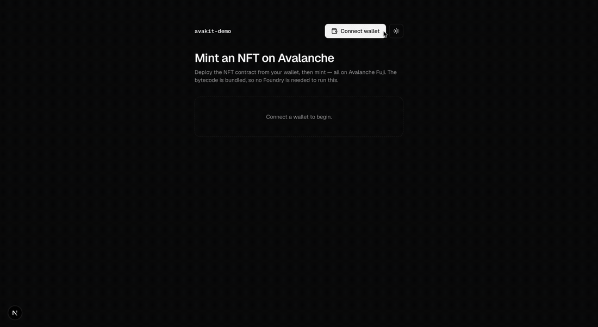

# AvaKit 🔺

> The open-source, AI-native developer toolkit for Avalanche.

[](https://www.npmjs.com/package/create-avalanche-app)
[](https://www.npmjs.com/package/@avakit/core)
[](https://www.npmjs.com/package/@avakit/react)
[](./LICENSE)
[](https://testnet.snowtrace.io/tx/0x9a1f139577964587ac03123d719f25c0b68024a4c8eab0dc258ad9c925a8e090)
[](https://youtu.be/GeSpcrmIpnc)

Scaffold a social-login dapp, deploy-ready, with agent context baked in. One core, four surfaces. **No seed phrases, no boilerplate.**

**[avakit.dev](https://avakit.dev)** · **[Documentation](https://avakit.dev/docs)** · **[Templates](https://avakit.dev/templates)**

## Try it

Three ways in. None of them needs a wallet extension, a private key of your own or an account with AvaKit or Avalanche.

1. **No install:** open **[avakit.dev/new](https://avakit.dev/new)**. The page deploys an NFT contract to the Fuji testnet and mints from it, in your browser.
2. **One command:** `npm create avalanche-app@latest`. It scaffolds a Next.js dapp from one of eight templates and installs it with the package manager you launched it with.
3. **From a coding agent:** `claude mcp add avakit -- npx -y @avakit/mcp`, then paste the prompt below. The agent scaffolds the app, deploys its contract and mints the first token, in three tool calls.

   > Create an NFT app called my-first-dapp with AvaKit, deploy its contract to Fuji and mint the first NFT. Give me the explorer links.

What pays for the first transaction: a temporary test wallet (in the browser for the first two ways, in the MCP server's memory for the third) that receives a little test AVAX from AvaKit's shared Fuji faucet. Both exist for a first run only; see [Status and limits](#status-and-limits).

> **▶ [Watch the 90-second demo](https://youtu.be/GeSpcrmIpnc)** — one command to a live, social-login Avalanche dapp: sign in with Google, deploy an NFT from the browser, and mint it on Fuji.


**Then deploy an NFT contract and mint it, straight from the browser, on Fuji:**



> **Proven live on Fuji.** The mint in that clip is a real on-chain transaction; [view it on Snowtrace](https://testnet.snowtrace.io/tx/0x9a1f139577964587ac03123d719f25c0b68024a4c8eab0dc258ad9c925a8e090) (contract [`0x7612…7786`](https://testnet.snowtrace.io/address/0x7612e031216250384ebdb151553a0c5b89b87786)). No Foundry, no backend: the bytecode is bundled and deployed from the user's wallet.

---

## How this relates to the official tools

Ava Labs maintains the official Avalanche tooling. [Builder Hub](https://build.avax.network) has a hosted prompt-to-contract flow in its Console (Studio, behind a Builder Hub sign-in), and the official MCP server gives an agent read access to Avalanche. AvaKit is an independent, open-source project that covers the local side of the same job: the app is created in your own folder, the MCP server runs on your own machine next to your coding agent, and on the Fuji testnet it can also deploy a contract and call it. AvaKit builds on the official stack (the public RPC endpoints, the AvaCloud Data API, Avalanche CLI) and links to Builder Hub for the faucet, the explorer and the documentation.

## Why AvaKit

Avalanche's C-Chain is EVM-compatible, and wallets such as Core already give end users a seedless social login. The setup work that remains is on the **developer** side: a new dapp needs wallet onboarding, a chain configuration, a contract to deploy and a UI before its first transaction. AvaKit ships those wired together.

- **Zero-setup onboarding**: a temporary in-browser wallet appears so a newcomer can try a real Fuji transaction with nothing installed, and social login (Google, no seed phrase) or Core/MetaMask is the upgrade — for those, keys stay with the wallet provider and AvaKit never touches them. (The temporary wallet is a deliberate exception, and holds its key in `localStorage` — see [SECURITY.md](SECURITY.md).)
- **AI-native by default**: every generated app ships `CLAUDE.md`, `llms.txt`, and `.cursor/rules`, and `@avakit/mcp` lets Claude Code / Cursor scaffold an app, deploy its contract, call it and read chain state for you. On Fuji that needs no key.
- **shadcn/ui, themed**: a clean design system with dark/light from day one. Copy-in components, no vendor lock-in.
- **Deploy-ready**: contracts compile to bundled bytecode, so you can deploy straight from the browser. Fuji testnet by default.
- **Safe defaults**: testnet-first, mainnet is explicit opt-in, secrets stay in env.
- **Wrap, don't rewrite**: built on viem, Web3Auth, and Foundry.

## Packages

| Package | What it is |
| --- | --- |
| [`@avakit/core`](https://www.npmjs.com/package/@avakit/core) | Framework-agnostic kernel: viem clients, wallet adapters, deploy helpers, chain data |
| [`@avakit/react`](https://www.npmjs.com/package/@avakit/react) | `<ConnectAvalanche>` social-login widget, `<TransactionButton>`, and hooks, built on shadcn/ui |
| [`create-avalanche-app`](https://www.npmjs.com/package/create-avalanche-app) | Batteries-included scaffolder (8 templates) |
| [`@avakit/mcp`](https://www.npmjs.com/package/@avakit/mcp) | MCP server: scaffold, deploy, call contracts (for example mint), and read Avalanche from Claude Code / Cursor |
| [`@avakit/studio`](https://www.npmjs.com/package/@avakit/studio) | Local dev dashboard: spin up devnets, send Interchain messages, inspect data (`npx @avakit/studio`); also an MCP server |

## Templates

```bash
npm create avalanche-app@latest my-app -- --template nft-mint
```

| Template | What you get |
| --- | --- |
| `minimal` | Social-login wallet, balance, and a first transaction |
| `nft-mint` | Deploy an ERC-721 from the browser, then mint |
| `token-gated-app` | Unlock content for holders of an access-pass NFT |
| `erc20-token` | Deploy an ERC-20, mint supply, and transfer |
| `icm-messenger` | Send a message between two Avalanche L1s over Interchain Messaging, on a one-command local devnet |
| `eerc-token` | Register, mint, and privately transfer tokens with hidden balances (Encrypted ERC) |
| `l1-launch` | Launch your own Avalanche L1 with one command, then explore it in a built-in dashboard |
| `token-bridge` | Bridge an ERC-20 between two Avalanche L1s with Interchain Token Transfer (ICTT) |

Every template ships with a wallet chooser (a zero-setup temporary wallet and Core/MetaMask, plus social login in the five Fuji templates), shadcn/ui (black & white, dark/light), and AI context files.

**The first transaction is funded on Fuji.** In `minimal`, `nft-mint`, `token-gated-app`, `erc20-token` and `eerc-token`, a new temporary wallet with an empty balance is sent test AVAX from AvaKit's shared faucet. The app shows what the faucet is doing; when the faucet refuses, it shows the reason, a **Try again** button and a link to the [official Fuji faucet](https://build.avax.network/console/primary-network/faucet), which needs a free Builder Hub sign-in. Set `NEXT_PUBLIC_AVAKIT_FAUCET_URL` to the `/fund` URL of your own faucet ([`services/faucet`](services/faucet)), or to `off` to ask no faucet at all.

**Testnet by default, mainnet only on purpose.** The templates target the Fuji testnet (`icm-messenger`, `l1-launch` and `token-bridge` run on a local devnet). Only `minimal` can also be scaffolded for C-Chain mainnet (`--chain c-chain`); the scaffolder refuses that chain for every other template, and a mainnet scaffold offers neither the temporary wallet nor a faucet. Every mainnet deploy is an explicit, guarded step: `deployContract()` and `useAvaDeploy()` refuse a mainnet chain unless you pass `confirmMainnet: true`, and then check that the account can pay for the deployment; the MCP server's `deploy_contract` and `write_contract` need your own key, `confirm: true` and `AVAKIT_ALLOW_MAINNET=1` in the server's environment. Details in the [scaffolder README](packages/create-avalanche-app/README.md) and [SECURITY.md](SECURITY.md).

## Use it in an existing app

```bash
npm install @avakit/react @avakit/core viem
```

```tsx
"use client";
import { injectedAdapter } from "@avakit/core";
import { fuji } from "@avakit/core/chains";
import { AvaKitProvider, ConnectAvalanche } from "@avakit/react";

export function App() {
  return (
    <AvaKitProvider chains={[fuji]} adapters={[injectedAdapter()]}>
      <ConnectAvalanche />
    </AvaKitProvider>
  );
}
```

Add social login by installing `@web3auth/modal` and passing `web3authAdapter({ clientId })` (from `@avakit/core/web3auth`).

> `@avakit/core` and `@avakit/react` are **ESM-only** (use `import`, not `require`; Node ≥ 22).

## Build with an AI agent

Add the MCP server to Claude Code with `claude mcp add avakit -- npx -y @avakit/mcp`, or to Cursor, Claude Desktop and other clients that read a JSON config:

```json
{
  "mcpServers": {
    "avakit": { "command": "npx", "args": ["-y", "@avakit/mcp"] }
  }
}
```

Then ask, for example: *"Create an NFT app called my-first-dapp with AvaKit, deploy its contract to Fuji and mint the first NFT. Give me the explorer links."*

The server has eight tools: `list_templates`, `scaffold_app`, `read_chain`, `estimate_gas`, `deploy_contract`, `write_contract`, `wallet_status` and `get_context`. What to know before you rely on it:

- **Fuji needs no key.** When `AVAKIT_DEPLOYER_KEY` is not set, `deploy_contract` and `write_contract` sign with a session test wallet: a key generated in the server's memory, never written to disk, logged or returned, that signs for Fuji only, never sends AVAX with a transaction, and is gone when the server stops. The server asks the shared faucet to fund it when it cannot pay. `AVAKIT_TEST_WALLET=0` turns it off, and `AVAKIT_DEPLOYER_KEY` replaces it with your own key.
- **Mainnet needs three things:** your own key in `AVAKIT_DEPLOYER_KEY`, `confirm: true` in the tool call, and `AVAKIT_ALLOW_MAINNET=1` in the server's environment, which a tool call cannot set.
- **Calls go only where you allow,** from the `@avakit/mcp` release after 0.2.1. `write_contract` calls only the contracts the server deployed in its session or that `AVAKIT_WRITE_ALLOWLIST` lists, and one call sends at most `AVAKIT_MAX_VALUE` AVAX (0.1 by default). Both limits hold per call, not per day.
- **Files stay in one folder.** `scaffold_app` creates projects, and `artifactPath` reads contract artifacts, only inside the server's working directory or the directory named by `AVAKIT_MCP_ROOT`. A server started in the filesystem root (as Claude Desktop does on macOS) refuses to scaffold until `AVAKIT_MCP_ROOT` is set.
- **The first start is a download.** `npx` fetches the server the first time a client starts it. It is published as one bundled file whose only dependency is the scaffolder, which comes to a few seconds on an empty npm cache. A client waits a fixed time for a server to connect (30 seconds in Claude Code), so on a slow network run `npx -y @avakit/mcp --version` once before adding it.

The full reference is the [`@avakit/mcp` README](packages/mcp/README.md).

## Status and limits

- **0.x pre-release.** All five packages are published on npm, and their APIs may still change before 1.0.
- **Testnet first.** Fuji is the default everywhere. Mainnet is an explicit, guarded step (see [Templates](#templates)), and only the `minimal` template can be scaffolded for C-Chain.
- **Three templates and the dashboard depend on Avalanche CLI.** `icm-messenger`, `l1-launch`, `token-bridge` and `@avakit/studio`'s Devnet, Launch on Fuji and Interchain views depend on Avalanche CLI (they run it, or work on the local L1s it set up), which Ava Labs put in maintenance mode in December 2025 and removed from the Avalanche documentation on 2026-10-06 in favour of Platform CLI. They were last proven end to end in July 2026. The next releases of the scaffolder and Studio label them experimental; create-avalanche-app 0.4.3 and Studio 0.1.14 do not. Moving them to the supported toolchain has not been done.
- **The shared faucet is a convenience with limits.** It is paid for by the maintainer and meant for first runs: one small drip per address per day, an hourly cap per network address, and it can be empty. When it refuses, the apps and the MCP server say why and point to the official faucet. Run your own ([`services/faucet`](services/faucet)) for anything beyond a first run.
- **Windows.** Native Windows is covered only by one leg of the end-to-end workflow below, which scaffolds and builds `nft-mint`; nobody has reported using AvaKit there yet. The setup scripts of the three local-devnet templates are bash and need WSL2.
- **What is checked automatically.** CI scaffolds and builds every template, and recompiles every bytecode artifact the repository ships, the `token-bridge` contracts from pinned `icm-contracts` sources included. Browser tests ([`apps/web/e2e`](apps/web/e2e)) drive avakit.dev/new and a scaffolded `nft-mint` app in Chromium against a local chain on every pull request. [`scripts/e2e-fuji.mjs`](scripts/e2e-fuji.mjs) goes through the agent path with only Node.js and npm: it scaffolds `nft-mint` through the MCP server, builds it, deploys the contract on Fuji and mints. A scheduled workflow runs it against the published packages on Linux, macOS and Windows runners, with the on-chain half on one of them. A run from this repository on 2026-11-18 deployed [`0xb7BC…392c`](https://build.avax.network/explorer/fuji/c-chain/address/0xb7BCb7D63851d84FcBb6A91555595D9503BB392c) and [minted from it](https://build.avax.network/explorer/fuji/c-chain/tx/0x104a9cef13f4b402de0f5483403823b450b0ea8fd61b3c66de85bdd731c7abe6).
- **Usage is small.** The scaffolder counts runs anonymously (opt out with `--no-telemetry`, `AVAKIT_TELEMETRY_DISABLED=1` or `DO_NOT_TRACK=1`), and the numbers are public at [avakit.dev/stats](https://avakit.dev/stats).
- **No outside run reported yet.** Nobody outside the project has reported a first run on their own machine; if you try AvaKit, a [first-run report](https://github.com/mericcintosun/AvaKit/issues/new?template=first-run-report.yml) (OS, Node.js version, path, minutes, what broke) is the most useful thing you can send.

The open engineering gaps are listed in [`docs/KNOWN-GAPS.md`](docs/KNOWN-GAPS.md).

## Maintenance and support

- **Who maintains it.** AvaKit has one maintainer, the owner of [this repository](https://github.com/mericcintosun/AvaKit). Contributions are welcome; see [`CONTRIBUTING.md`](./CONTRIBUTING.md).
- **Bugs and questions.** Open a [GitHub issue](https://github.com/mericcintosun/AvaKit/issues).
- **Vulnerabilities.** Report them privately through [GitHub's private vulnerability reporting](https://github.com/mericcintosun/AvaKit/security/advisories/new), not in a public issue. [`SECURITY.md`](SECURITY.md) describes what AvaKit does with keys.
- **Releases.** Versions and changelogs come from [Changesets](https://github.com/changesets/changesets). Packages are published only by the release workflow, through npm trusted publishing (OIDC) with a provenance attestation, after lint, typecheck and tests pass on the commit being released and the maintainer approves the publish. See [`RELEASING.md`](RELEASING.md).
- **Node.js versions.** AvaKit is tested on Node.js 22, 24 and 26, and needs Node.js 22 or newer (Node.js 20 reached end of life in April 2026). The scaffolder stops with one line before creating anything on an older one. Every package declares `>=22` (up to core and react 0.2.2, mcp 0.2.1 and studio 0.1.14, the libraries declared `>=20.11`).
- **Dependency updates.** Dependabot opens weekly pull requests for the workspace, the two Workers and the pinned GitHub Actions. The templates' dependencies are bumped by hand, and CI fails when two templates pin different versions of a dependency they share.

## Repository layout

```
packages/
  core/                 @avakit/core
  react/                @avakit/react
  mcp/                  @avakit/mcp
  studio/               @avakit/studio (local dashboard + MCP)
  create-avalanche-app/ scaffolder + 8 templates
apps/web/               the avakit.dev site (EN + TR)
examples/               live demo dapps (hello-avax, web3auth-demo)
services/               faucet + telemetry Cloudflare Workers
contracts-ci/           Foundry tests + artifact check for the shipped contracts
scripts/                repo scripts (template smoke test, end-to-end Fuji run, template dependency check)
docs/                   planning, PRD, architecture, ADRs, specs, security review, known gaps
```

## Contributing

```bash
pnpm install
pnpm build       # all packages (Turborepo)
pnpm test        # Vitest
pnpm lint        # Biome
pnpm typecheck   # TypeScript
```

Requirements: Node ≥ 22.18 (CI runs on Node 22 and 24), pnpm ≥ 10. See [`CONTRIBUTING.md`](./CONTRIBUTING.md) and the design docs in [`docs/`](./docs). Conventions: English everywhere, shadcn/ui only, Framer Motion / GSAP for animation, latest stable versions.

## License

[MIT](./LICENSE) © AvaKit contributors

---

<sub>Built on [viem](https://viem.sh), [Web3Auth](https://web3auth.io), [Foundry](https://getfoundry.sh), and [shadcn/ui](https://ui.shadcn.com). Testnet-first (Fuji); mainnet is opt-in.</sub>
